## Co je na mapě? {.center}

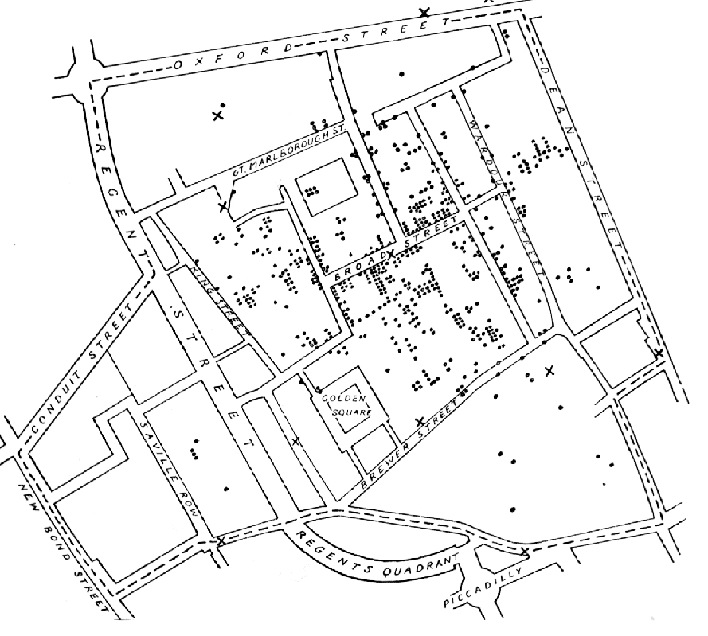{.r-stretch fig-align="center"}

::: notes
Nechat publikum hádat 1–2 minuty. Kde to je? Co znamenají tečky a křížky?
Typické tipy: obchody, hospody, zločiny, domy… Neprozrazovat.
:::

## Londýn, Soho, 1854: cholera

:::: {.columns}
::: {.column width="55%"}
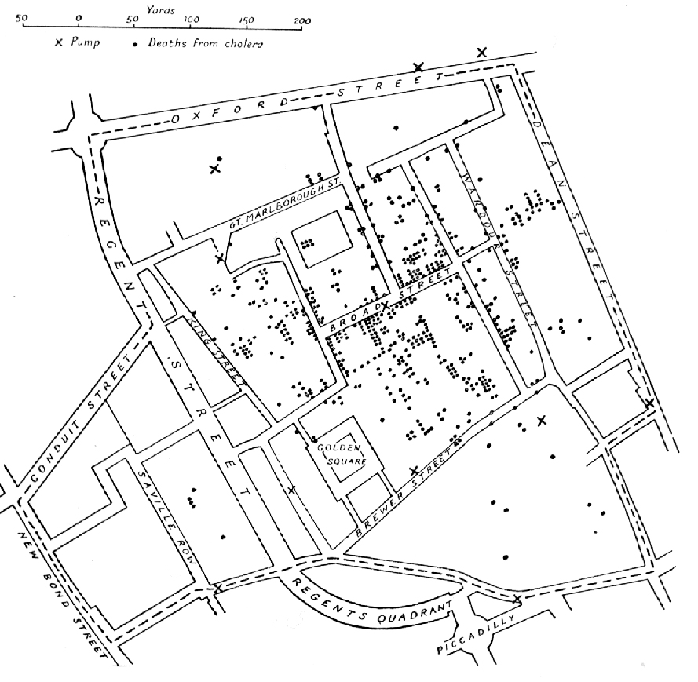{height="600"}
:::
::: {.column width="45%"}
- **tečky** = úmrtí na choleru
- **×** = veřejné pumpy na vodu
- John Snow, lékař
- tehdy převládá teorie **miasmatu** (nemoc z „morového vzduchu")
- Snow tvrdí: nemoc se šíří **vodou**
:::
::::

::: notes
Srpen–září 1854, za pár dní přes 500 mrtvých. Snow zakreslil úmrtí podle adres do mapy.
Otázka na sál: Kde byste hledali zdroj nákazy?
:::

## Kde je zdroj?

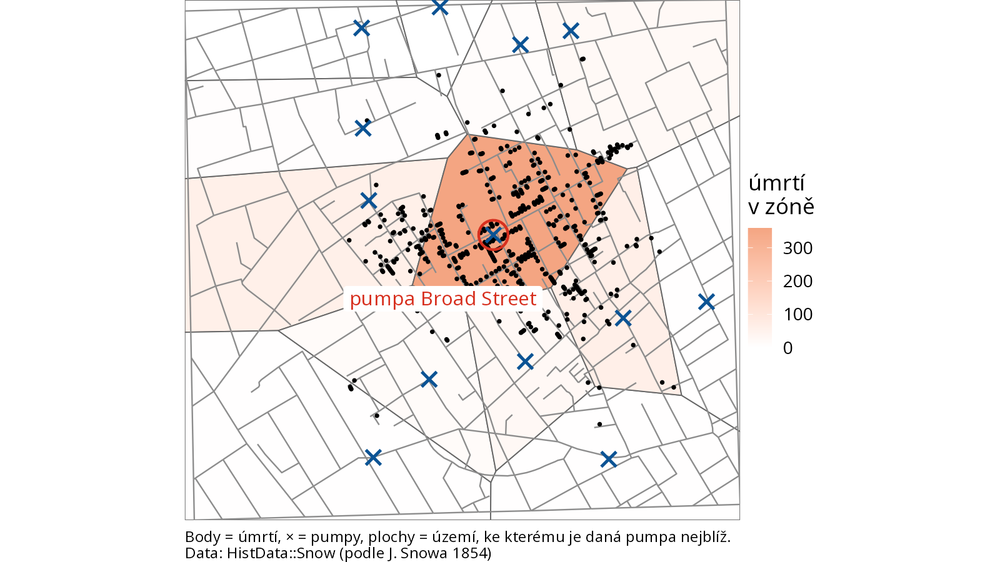{.r-stretch fig-align="center"}

::: notes
Stejná data, jen překreslená: každá plocha = území, ke kterému je daná pumpa nejblíž
(Thiessenovy/Voronoiovy polygony). Z 578 úmrtí jich 359 spadá do zóny pumpy na Broad Street.
Snow nechal odmontovat rukojeť pumpy, epidemie ustala (už ale i tak slábla).
Pointa: **kde** (poloha) + **co** (atribut) + jednoduchá prostorová analýza = nové poznání.
To je GIS.
:::

## Proč GIS v archeologii a památkách?

- **Kde** se věci nacházejí, a **jak spolu souvisí** v prostoru
  - rozptyl nálezů v sondě, na ploše prospekce
  - poloha lokalit vůči vodě, terénu, cestám
  - co leží v trase plánované stavby?
- Mapa je výsledek; **GIS** je nástroj, jak data **uložit, propojit, analyzovat a zobrazit**

::: notes
Most k publiku: stejná logika jako Snow. Odpoledne budeme dělat přesně tohle:
přehled lokalit v blízkosti liniové stavby.
:::

## Svět jako vrstvy (layers)

:::: {.columns}
::: {.column width="40%"}
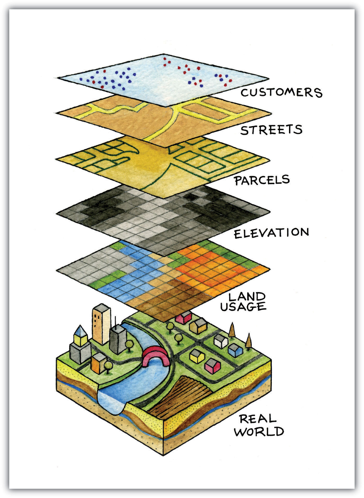{height="620"}
:::
::: {.column width="60%"}
- realitu **zjednodušujeme** na tematické vrstvy
- každá vrstva = **jeden typ** dat
- vrstvy se překrývají díky **společným souřadnicím**
- v QGIS: panel **Layers**
:::
::::

::: notes
Model krajiny: nikdy nezachytíme vše, vybíráme, co potřebujeme.
Vrstvy fungují jen proto, že všechny „sedí" na stejném místě – k tomu se vrátíme u CRS.
:::

# Rastr a vektor

## Dva způsoby, jak popsat svět

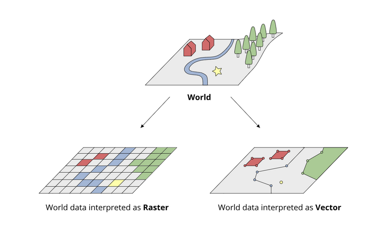{.r-stretch fig-align="center"}

## Naše (smyšlená) krajina

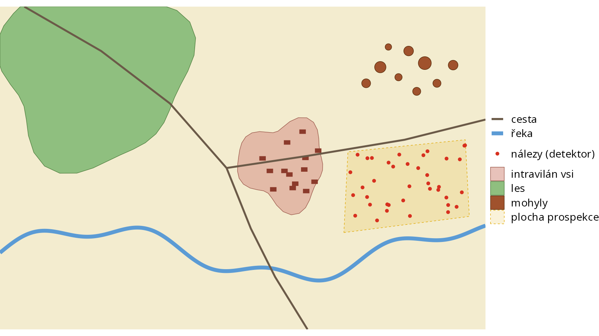{.r-stretch fig-align="center"}

::: notes
Celou dobu budeme pracovat s touto smyšlenou krajinou: řeka, cesty, ves, les,
mohylník a plocha detektorové prospekce s nálezy.
:::

## Stejná krajina: vektor vs. rastr

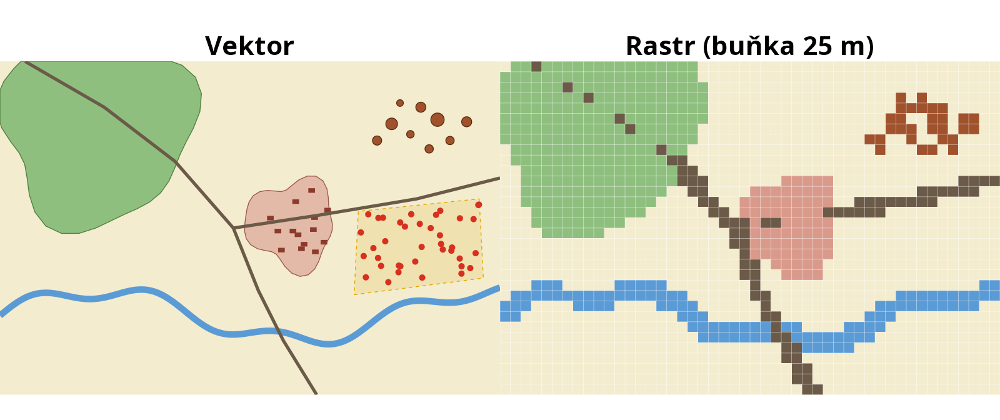{.r-stretch fig-align="center"}

:::: {.columns}
::: {.column width="50%"}
**Vektor (vector)**: objekty jako body, linie, plochy se souřadnicemi
:::
::: {.column width="50%"}
**Rastr (raster)**: pravidelná mřížka buněk (pixelů), každá má jednu hodnotu
:::
::::

::: notes
Vektor: přesné hranice, každý objekt zvlášť, k němu tabulka.
Rastr: všechno je mřížka, malé objekty (domy) zmizí nebo se „rozsypou".
:::

## Rozlišení rastru (resolution)

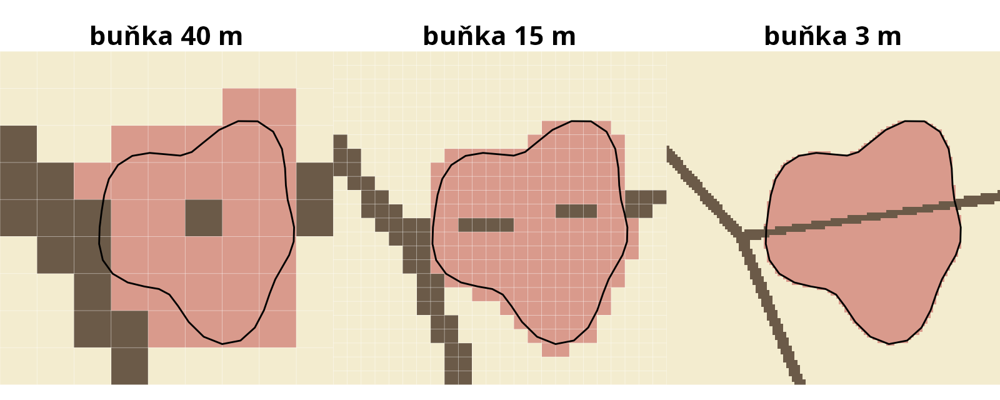{.r-stretch fig-align="center"}

- velikost buňky určuje, **co ještě uvidíme**
- menší buňka = víc detailů, ale **větší soubor**

::: notes
Černá linie = skutečná hranice vsi (vektor). Při 40 m je ves pár čtverečků,
cesta se rozpadá; při 3 m je to skoro jako vektor, ale dat je 180× víc.
:::

## Rastr: spojité jevy

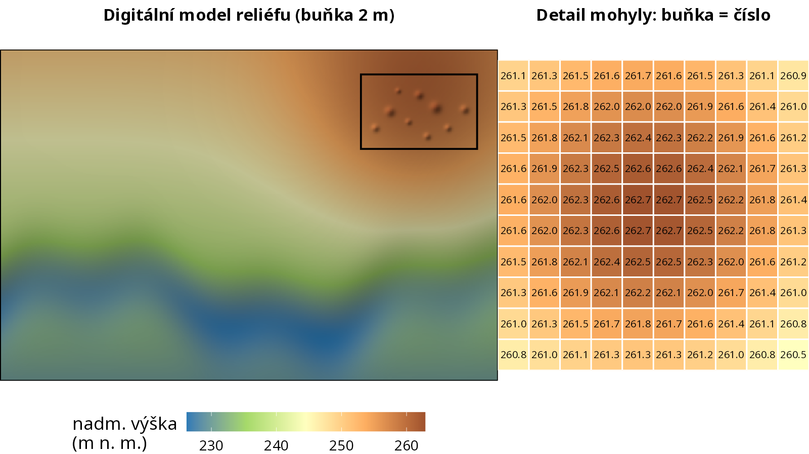{.r-stretch fig-align="center"}

::: notes
Digitální model reliéfu (DMR, DEM): v každé buňce nadmořská výška.
Ze stínovaného reliéfu (hillshade) jsou vidět mohyly, i když jsou v lese.
Reálně: DMR 5G z ČÚZK (LiDAR), bude dostupné jako WMS.
:::

## Kdy rastr, kdy vektor?

| | **Rastr** | **Vektor** |
|---|---|---|
| co | spojité jevy, obrázky | jednotlivé objekty |
| příklady | ortofoto, DMR / LiDAR, naskenovaná stará mapa, letecký snímek | lokality, nálezy, sondy, objekty, cesty |
| hodnota | jedna hodnota na buňku | tabulka atributů na objekt |
| v QGIS | *Raster layer* | *Vector layer* |

::: notes
Naskenovaný plán nebo stará mapa je rastr: odpoledne ho georeferencujeme (Tomáš Pavloň).
Vektory budeme kreslit dopoledne.
:::

# Vektorová data

## Body, linie, polygony

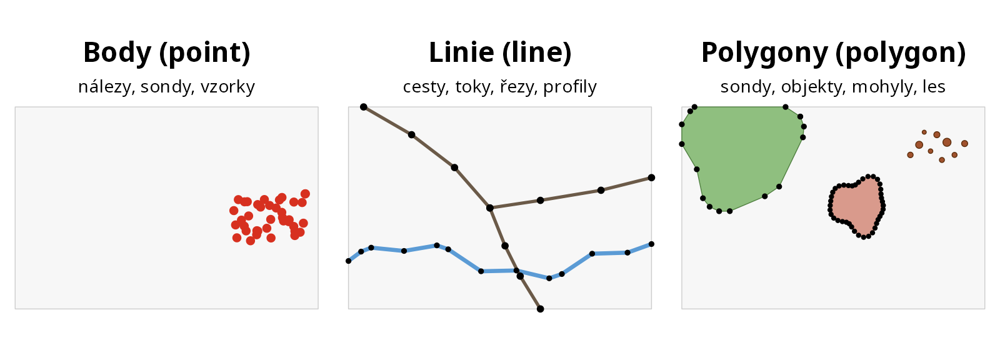{.r-stretch fig-align="center"}

- objekt = **vrcholy (vertices)** se souřadnicemi, spojené čarami
- **jedna vrstva = jeden typ geometrie**

::: notes
Bod: jeden pár souřadnic. Linie: řada bodů. Polygon: uzavřená linie.
Co je bod a co polygon, záleží na měřítku: lokalita může být bod na mapě ČR a polygon v plánu.
Vrstva nemůže míchat body a polygony: proto budeme zakládat zvlášť vrstvu bodů, linií a ploch.
:::

## Atributová tabulka (attribute table)

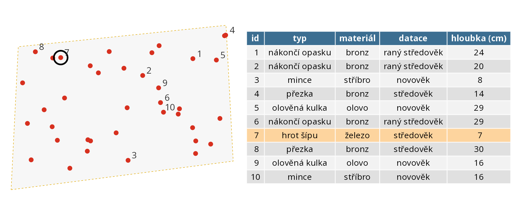{.r-stretch fig-align="center"}

- **řádek = jeden objekt**, **sloupec = vlastnost** (atribut)
- podle atributů lze objekty **filtrovat, vybírat, barvit, popisovat**

::: notes
Geometrie + tabulka = to je vektorová vrstva. Kliknu na bod na mapě → zvýrazní se řádek, a naopak.
Typ sloupce (text, celé číslo, desetinné číslo, datum) se volí při zakládání vrstvy.
:::

## Body z tabulky

- tabulka (CSV, XLSX) se sloupci **X a Y** (nebo zeměpisná délka a šířka)
- QGIS z ní udělá bodovou vrstvu (*Add Delimited Text Layer*)
- musíme vědět, **v jakém souřadnicovém systému** souřadnice jsou

```
id;typ;X;Y
1;mince;-597212.4;-1161480.9
2;spona;-597198.0;-1161502.3
```

::: notes
Data v Part 2: sondy_XY.txt, keramika.csv, kosti.csv, kovy.csv.
Souřadnice z totální stanice nebo GNSS: skoro vždy S-JTSK (záporná čísla v metrech).
:::

# Formáty

## Shapefile vs. GeoPackage

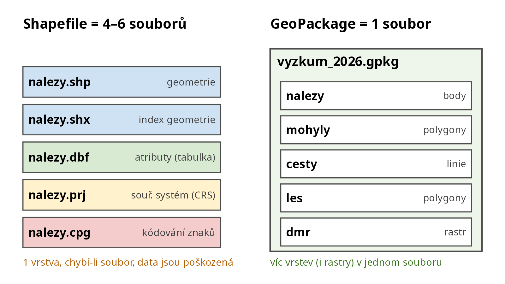{.r-stretch fig-align="center"}

::: notes
Shapefile: starý formát firmy ESRI (1990s), pořád nejrozšířenější. Nikdy neposílejte jen .shp!
Omezení: názvy sloupců max. 10 znaků, problémy s češtinou (kódování), max 2 GB, jedna vrstva.
GeoPackage: otevřený standard (OGC), jeden soubor (SQLite), víc vrstev, i rastry, i styly.
Doporučení: ukládejte do GeoPackage. Výchozí formát v QGIS.
:::

## Další formáty, se kterými se potkáte

:::: {.columns}
::: {.column width="50%"}
**Vektor**

- **CSV / XLSX** s X, Y: body z tabulky
- **GeoJSON**: jeden textový soubor, web
- **KML / KMZ**: Google Earth
- **GPX**: GPS přijímače
- **DXF / DWG**: CAD, plány z totální stanice
:::
::: {.column width="50%"}
**Rastr**

- **GeoTIFF** (.tif): obrázek + souřadnice
- JPG / PNG + world file (.jgw, .pgw)

**Webové služby** (nic se nestahuje)

- **WMS**: hotový obrázek mapy (ortofoto, ZTM)
- **WFS**: vektorová data i s atributy
:::
::::

::: notes
QGIS otevře skoro cokoli (knihovna GDAL).
Odkazy na WMS/WFS služby ČÚZK, NPÚ aj. jsou v README repozitáře.
:::

# Souřadnicové systémy (CRS)

## Země není koule (ani placka)

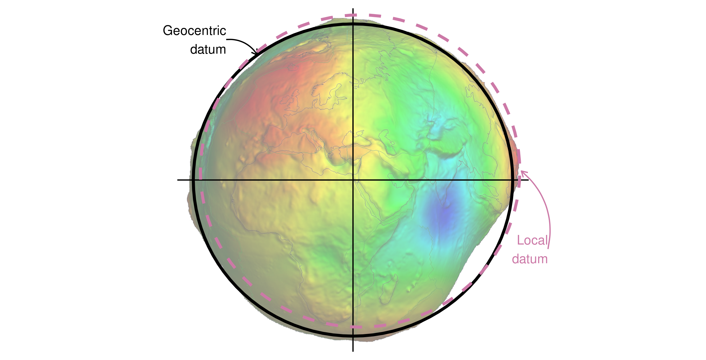{.r-stretch fig-align="center"}

::: notes
Skutečný tvar Země (geoid) je nepravidelný. Nahrazujeme ho elipsoidem.
Globální elipsoid (WGS 84, GPS) vs. lokální, který lépe sedí na jedno území (Bessel pro S-JTSK).
Stačí vědět, že existuje víc „modelů Země" a data se k nim vztahují.
:::

## Mapa = zploštění Země (projekce)

:::: {.columns}
::: {.column width="50%"}
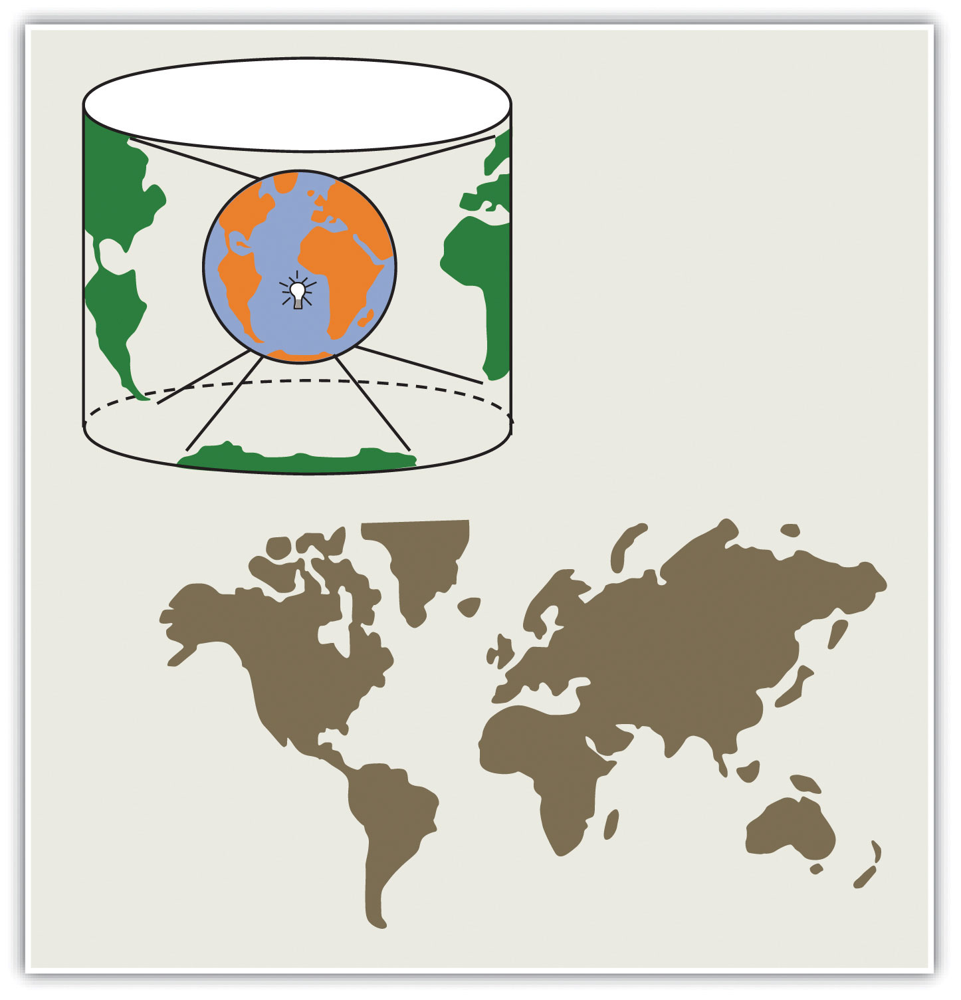{height="580"}
:::
::: {.column width="50%"}
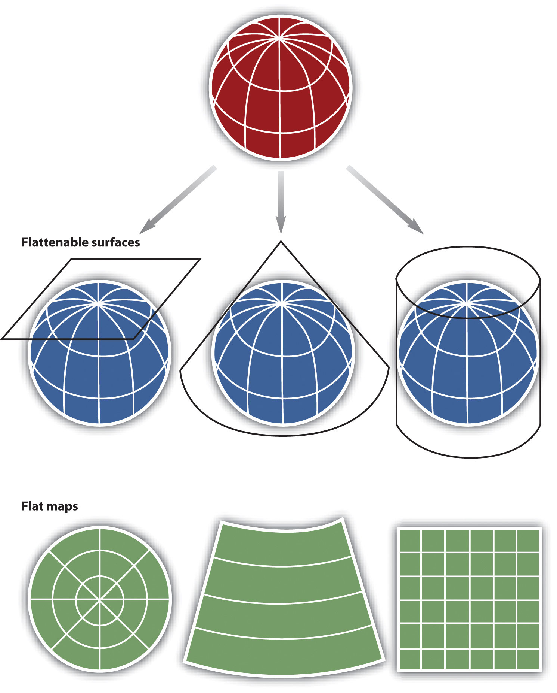{height="580"}
:::
::::

::: notes
Kouli nejde rozložit do roviny bez deformace (pomeranč).
Každá projekce něco zkresluje: plochy, úhly, vzdálenosti. Pro malé území (ČR) je zkreslení malé.
:::

## Stejná ČR, tři souřadnicové systémy

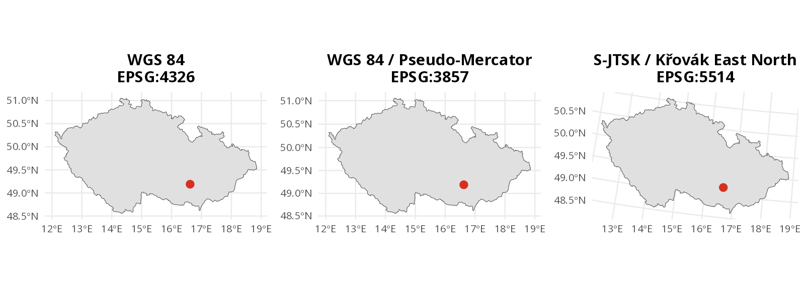{.r-stretch fig-align="center"}

- **zeměpisné** (geographic): stupně, na elipsoidu
- **rovinné / projektované** (projected): metry, v rovině mapy

::: notes
Všimněte si, jak je S-JTSK „natočený": Křovákovo zobrazení je šikmé kuželové,
navržené tak, aby mělo na území ČSR co nejmenší zkreslení.
Web Mercator: Google, OSM, podkladové dlaždice (XYZ tiles).
:::

## Jeden bod, tři zápisy

Archeologický ústav AV ČR, Brno (Čechyňská 363/19):

| CRS | EPSG | souřadnice | jednotky |
|---|---|---|---|
| WGS 84 (GPS) | **4326** | 49,18913° N, 16,62125° E<br>N 49° 11′ 20,9″, E 16° 37′ 16,5″ | stupně |
| S-JTSK / Křovák East North | **5514** | X = −597 273, Y = −1 161 518 | metry |
| WGS 84 / UTM 33N | **32633** | E = 618 130, N = 5 449 746 | metry |

**EPSG kód** = jednoznačné „jméno" souřadnicového systému

::: notes
V ČR: S-JTSK (5514) pro katastr, ZABAGED, ČÚZK, většina výzkumů. WGS 84 pro GPS, mobil, Google.
V QGIS stačí hledat číslo EPSG. Záporná čísla v řádu stovek tisíc / milionu = S-JTSK.
:::

## Co se může pokazit

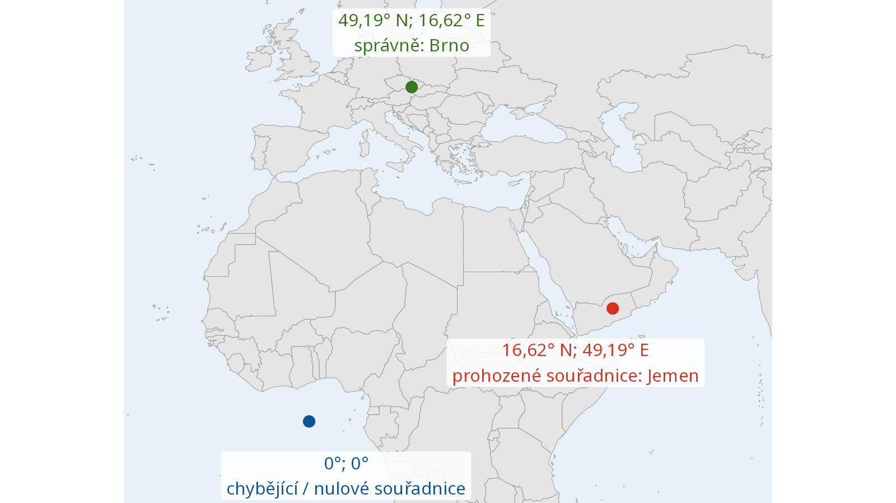{.r-stretch fig-align="center"}

::: notes
Prohozené pořadí: zeměpisná šířka (lat, Y) vs. délka (lon, X). Excel a GPS to píšou obráceně.
Chybějící CRS nebo nuly: data skončí v Guinejském zálivu na 0°, 0°.
Data v S-JTSK označená jako WGS 84 (nebo naopak): vrstva je úplně mimo nebo se neukáže.
:::

## CRS v QGIS: co si zapamatovat

- **každá vrstva** má svůj CRS a **projekt** má svůj CRS
- QGIS převádí vrstvy do CRS projektu **za běhu** (on-the-fly)
- vrstva „není vidět" nebo je jinde → **zkontroluj CRS vrstvy**
- vzdálenosti a plochy měř v systému **v metrech** (S-JTSK, UTM)
- v ČR typicky: projekt v **EPSG:5514**

::: notes
Nejčastější problém začátečníků: CRS vrstvy přiřazen špatně.
Rozlišovat: *Set Layer CRS* (jen opravím „nálepku") vs. *Reproject / Export* (převedu souřadnice).
:::

## Shrnutí

1. **Poloha + atributy** → nové poznání (John Snow)
2. GIS skládá svět z **vrstev**
3. **Rastr** = mřížka hodnot, **vektor** = body, linie, polygony + tabulka
4. Ukládejte do **GeoPackage**; shapefile = několik souborů
5. Každá data mají **CRS**; v ČR hlavně **S-JTSK (EPSG:5514)** a **WGS 84 (EPSG:4326)**

**A teď do QGIS!**

## Zdroje obrázků {.smaller}

- J. Snow (1855): *On the Mode of Communication of Cholera*, mapa Soho (volné dílo).
  Data: R balík `HistData` (`Snow.deaths`, `Snow.pumps`, `Snow.streets`).
- Vrstvy, projekce: J. Campbell, M. Shin: *Essentials of Geographic Information Systems*
  (Saylor Foundation, CC BY-NC-SA 3.0).
- Geocentrické a lokální datum: R. Lovelace, J. Nowosad, J. Muenchow:
  *Geocomputation with R* (CC BY-NC-ND 4.0).
- Ostatní obrázky a smyšlená krajina: vlastní, skript
  [`Part 1/R/figures.R`](https://github.com/arubrno/qgis-workshop/blob/main/Part%201/R/figures.R).
- Hranice ČR a států: © EuroGeographics (GISCO, balík `giscoR`).
