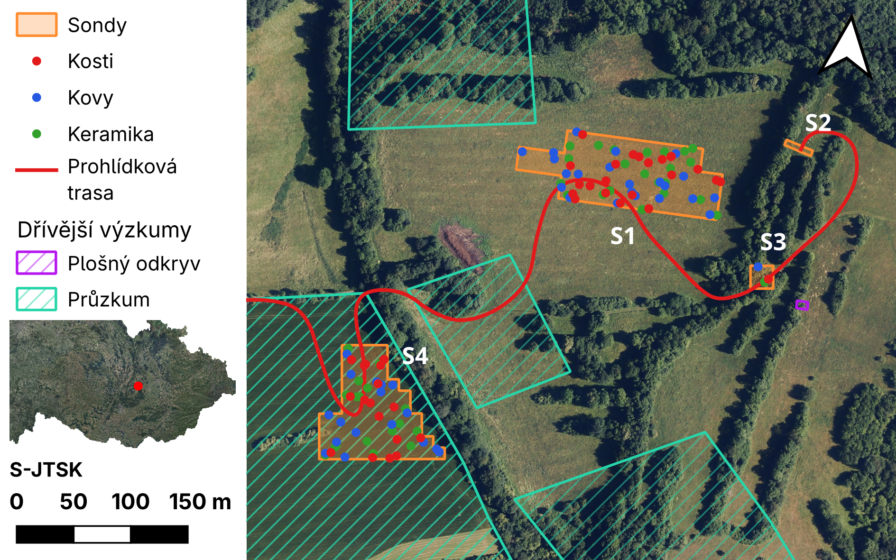

# Část 2 – návod krok za krokem

Tento návod kopíruje postup, který na workshopu ukazujeme naživo. Když
nestíháte, najděte si tady krok, u kterého jsme, a pokračujte podle něj.
Výsledkem je mapa výzkumu se sondami, nálezy, prohlídkovou trasou
a dřívějšími výzkumy z AMČR:



Názvy tlačítek a nabídek jsou uvedené anglicky, tak jak je uvidíte v QGIS
3.44 v angličtině. Cesta v nabídce se zapisuje šipkami, např.
**Project → Save As…** znamená „v horní nabídce Project klikněte na
Save As…".

> **Ukládejte průběžně.** Kdykoli uvidíte 💾, stiskněte `Ctrl+S`. QGIS
> občas spadne a o neuložený projekt přijdete.

## Obsah

- [Příprava dat](#příprava-dat)
- [A. Prostředí a projekt](#a-prostředí-a-projekt) (kroky 0–2)
- [B. Sondy](#b-sondy) (kroky 3–8)
- [C. Nálezy](#c-nálezy) (kroky 9–12)
- [D. Prohlídková trasa](#d-prohlídková-trasa) (kroky 13–14)
- [E. Plugin AMČR Viewer](#e-plugin-amčr-viewer) (kroky 15–19)
- [F. Mapový výstup (layout)](#f-mapový-výstup-layout) (kroky 20–31)
- [Když se ztratíte](#když-se-ztratíte)

## Příprava dat

1. Stáhněte si repozitář workshopu:
   <https://github.com/arubrno/qgis-workshop> → zelené tlačítko **Code →
   Download ZIP**.
2. ZIP rozbalte, např. do složky `Dokumenty`.
3. Ve složce `Part 2` najdete vstupní data:
   - `sondy_XY.txt` – lomové body sond zaměřené totální stanicí,
   - `keramika.csv`, `kosti.csv`, `kovy.csv` – zaměřené nálezy.

Pro vlastní práci si založte složku, kam budete ukládat projekt
i geopackage – kde, je na vás. Projekt a `workshop.gpkg` ale mějte ve stejné
složce. Složka `cheat` obsahuje hotové řešení – do ní nic neukládejte, ať si
ho nepřepíšete.

---

## A. Prostředí a projekt

### Krok 0 – orientace v QGIS

Po spuštění QGIS zvolte vlevo nahoře **New Empty Project** (nebo
**Project → New**, `Ctrl+N`). Okno se skládá z těchto částí:

- **Horní nabídka a lišty nástrojů** – všechny příkazy. Když nějaká lišta
  chybí, zapnete ji v **View → Toolbars**.
- **Browser** (vlevo nahoře) – průzkumník souborů a online služeb (WMS,
  WFS…). Odtud se vrstvy přetahují do projektu.
- **Layers** (vlevo dole) – vrstvy v projektu. Co je výš, kreslí se nahoře.
  Zaškrtávátkem vrstvu skryjete, dvojklikem otevřete její vlastnosti
  (**Layer Properties**).
- **Mapové okno** (uprostřed) – samotná mapa. Kolečkem myši přibližujete,
  se stisknutým kolečkem (nebo mezerníkem) posouváte.
- **Stavový řádek** (dole) – souřadnice kurzoru, měřítko a vpravo dole
  souřadnicový systém (CRS) projektu.

Když zavřete panel Browser nebo Layers, vrátíte ho přes **View → Panels**.

### Krok 1 – souřadnicový systém a uložení projektu

1. Klikněte vpravo dole ve stavovém řádku na kód CRS (např. `EPSG:4326`).
   Otevře se **Project Properties → CRS**.
2. Do pole **Filter** napište `5514` a vyberte
   **S-JTSK / Krovak East North (EPSG:5514)**. Potvrďte **OK**.
3. Projekt uložte: **Project → Save As…** do své pracovní složky, název
   `workshop.qgz`. 💾

Odteď stačí ukládat přes `Ctrl+S`.

### Krok 2 – podkladové mapy (WMS)

Podkladové mapy nebudeme stahovat, načteme je jako webovou službu přímo
od ČÚZK.

1. V panelu **Browser** klikněte pravým tlačítkem na **WMS/WMTS → New
   Connection…**.
2. Vyplňte **Name** a **URL** a potvrďte **OK**. Postup zopakujte pro
   všechny tři služby:

   | Name     | URL |
   |----------|-----|
   | ZTM5     | `https://ags.cuzk.gov.cz/arcgis1/services/ZTM/ZTM5/MapServer/WMSServer` |
   | DMR 5G   | `https://ags.cuzk.gov.cz/arcgis2/services/dmr5g/ImageServer/WMSServer` |
   | Ortofoto | `https://ags.cuzk.gov.cz/arcgis1/services/ORTOFOTO/MapServer/WMSServer` |

3. Rozbalte připojení v Browseru (šipka vlevo) a vrstvu přetáhněte do
   mapy, případně na ní dejte pravé tlačítko → **Add Layer to Project**.
   - u ZTM5 a Ortofota je uvnitř jedna vrstva,
   - u DMR 5G vyberte stínovaný reliéf **GrayscaleHillshade**.
4. Nechte zapnutou jen jednu podkladovou vrstvu, ostatní skryjte
   zaškrtávátkem. Kterou, je na vás – lektor pracuje s ortofotem.
5. 💾

> **WMS, WFS, ArcGIS REST – v čem je rozdíl?**
>
> - **WMS/WMTS** posílá hotové *obrázky* mapy. Rychlé a pohodlné na
>   podklad, ale s daty nejde pracovat (vybírat, měřit, stylovat).
> - **WFS** posílá *vektorová data* i s atributy, takže je můžete
>   stylovat, filtrovat a analyzovat. Příklad: Data50 od ČÚZK,
>   `https://ags.cuzk.gov.cz/arcgis/services/DATA50/MapServer/WFSServer`
>   (v Browseru **WFS / OGC API - Features**).
> - **ArcGIS REST** je rozhraní serverů ArcGIS; umí obrázky i vektory.
>   Příklad: území s archeologickými nálezy (ÚAN) od NPÚ,
>   `https://geoportaltest.npu.cz/arcgis/rest/services/ISAD/Uzemi_archeologickeho_nalezu_public/MapServer`
>   (v Browseru **ArcGIS REST Servers**).

---

## B. Sondy

### Krok 3 – import lomových bodů z totální stanice

Soubor `sondy_XY.txt` je obyčejný text: na každém řádku souřadnice X, Y,
označení sondy a pořadí bodu, oddělené mezerou.

1. **Layer → Data Source Manager** (`Ctrl+L`) → vlevo **Delimited Text**.
2. **File name**: tlačítkem `…` vyberte `Part 2/sondy_XY.txt`.
3. **File Format**: **Custom delimiters** a zaškrtněte jen **Space**.
4. **Geometry Definition**: **Point coordinates**,
   **X field** = `X`, **Y field** = `Y`.
5. **Geometry CRS**: `EPSG:5514 - S-JTSK / Krovak East North`.
6. Dole v **Sample Data** zkontrolujte, že se data rozdělila do čtyř
   sloupců `X`, `Y`, `sonda`, `poradi`.
7. **Add**, pak **Close**.
8. Pravým tlačítkem na vrstvu `sondy_XY` → **Zoom to Layer(s)**. Měli byste
   vidět body na louce u Starého Hradiska.

> **Body se neobjevily, nebo jsou jinde?** Nejčastěji je špatně Geometry
> CRS. Vrstvu odeberte (pravé tlačítko → **Remove Layer…**) a importujte
> znovu.

### Krok 4 – nový GeoPackage s vrstvou `sondy`

GeoPackage (`.gpkg`) je jeden soubor, do kterého se vejde libovolný počet
vrstev. Všechno, co vytvoříme, poputuje do něj.

1. **Layer → Create Layer → New GeoPackage Layer…** (`Ctrl+Shift+N`).
2. **Database**: tlačítkem `…` zvolte svou pracovní složku a název
   `workshop.gpkg`.
3. **Table name**: `sondy`.
4. **Geometry type**: **Polygon**.
5. CRS: `EPSG:5514`.
6. V části **New Field**:
   - **Name**: `c_sondy`,
   - **Type**: **Text Data**,
   - klikněte na **Add to Fields List**. Pole se objeví v seznamu dole.
7. **OK**. Vrstva `sondy` se přidá do projektu (zatím prázdná).
8. 💾

### Krok 5 – popisky lomových bodů

Abychom věděli, v jakém pořadí body obkreslovat, zobrazíme u nich číslo.

1. Dvojklik na `sondy_XY` → **Labels**.
2. Nahoře zvolte **Single Labels**.
3. **Value**: pole `poradi`. Lepší je ale i název sondy: klikněte na
   tlačítko **ε** vedle pole a napište výraz

   ```
   "sonda" || '_' || "poradi"
   ```

   Popisky pak budou vypadat jako `S4_1`, `S4_2`…
4. V záložkách vlevo dole zvolte **Placement**:
   - **Mode**: **Offset from Point**,
   - **Quadrant**: pravý horní čtvereček,
   - **Offset X,Y**: `1` a `1` (jednotky mm).
5. **OK**.

### Krok 6 – obkreslení sond

Polygony sond nakreslíme tak, že se budeme „přichytávat" k zaměřeným
bodům. Na to slouží **snapping**.

**Zapnutí snappingu**

1. **View → Toolbars → Snapping Toolbar** (pokud lišta s magnetem ještě
   není vidět).
2. Klikněte na ikonu **magnetu** (zapnout).
3. V rozbalovacím menu vedle zvolte **Vertex** (přichytávat k bodům).
   Tolerance kolem `12 px` stačí.

**Kreslení**

1. V panelu Layers označte vrstvu `sondy`.
2. Zapněte editaci: ikona **tužky** (**Toggle Editing**).
3. Zvolte **Add Polygon Feature** (`Ctrl+.`).
4. Přibližte si jednu sondu a klikejte postupně na její body v pořadí
   podle popisků (`S4_1`, `S4_2`, …). U každého bodu by se měl objevit
   fialový čtvereček – to je přichycení.
5. Polygon ukončete **pravým tlačítkem**. Nemusíte znovu klikat na první
   bod, QGIS polygon uzavře sám.
6. Do okna s atributy napište **c_sondy** = `S4` (podle popisků; ve
   formátu `S1`, `S2`…). **OK**.
7. Stejně nakreslete zbylé tři sondy – každou jako samostatný polygon.
8. Uložte změny: ikona **Save Layer Edits** (disketa s tužkou) vedle
   tužky.
9. Vypněte editaci kliknutím na tužku. Kdyby se QGIS ptal, zda uložit,
   zvolte **Save**.
10. 💾

> **Platí pro každou editaci kterékoli vrstvy:** po dokreslení uložte
> změny vrstvy (**Save Layer Edits**) a vypněte editaci. Uložení projektu
> (`Ctrl+S`) změny ve vrstvě *neukládá*.

> **Spletli jste se?** Během kreslení vrací `Backspace` poslední bod,
> `Esc` zruší celý polygon. Hotový polygon smažete nástrojem **Select
> Features** (klik na polygon) a klávesou `Delete`.

### Krok 7 – styl sond

1. Dvojklik na `sondy` → **Symbology**.
2. Nechte **Single Symbol** a ve stromu symbolu klikněte na **Simple
   Fill**.
3. **Fill color**: klikněte na barvu, do pole **HTML notation** napište
   `#ff9036` a posuvník **Opacity** dejte na `30 %`.
4. **Stroke color**: `#ff8d30`, opacity `100 %`.
5. **Stroke width**: `0,46` mm.
6. **Fill style** i **Stroke style**: **Solid**.
7. **OK**.

### Krok 8 – popisky sond

1. Dvojklik na `sondy` → **Labels** → **Single Labels**, **Value** =
   `c_sondy`.
2. Záložka **Text**:
   - **Font**: libovolné bezpatkové písmo, např. *Open Sans*,
   - **Style**: **Bold**,
   - **Size**: `12` pt,
   - **Color**: bílá.
3. Záložka **Placement**:
   - **Mode**: **Outside Polygons**,
   - **Distance**: `3` mm.
4. **OK**. 💾

---

## C. Nálezy

### Krok 9 – import nálezů z CSV

Nálezy jsou také zaměřené totální stanicí. Postup je stejný jako
v kroku 3, jen jde o CSV oddělené čárkou.

1. **Layer → Data Source Manager** (`Ctrl+L`) → **Delimited Text**.
2. **File name**: `Part 2/keramika.csv`.
3. **File Format**: **CSV (comma separated values)**.
4. **Geometry Definition**: **Point coordinates**, **X field** = `X`,
   **Y field** = `Y`, **Geometry CRS** = `EPSG:5514`.
5. **Add**.
6. Zopakujte pro `kosti.csv` a `kovy.csv`.

Vrstvy z CSV jsou jen „okno" do textového souboru – nejdou pořádně
editovat a jsou závislé na tom, kde CSV leží. Proto je hned převedeme do
GeoPackage.

### Krok 10 – export nálezů do `workshop.gpkg`

1. Pravým tlačítkem na vrstvu `keramika` → **Export → Save Features
   As…**.
2. **Format**: **GeoPackage**.
3. **File name**: tlačítkem `…` vyberte *existující* `workshop.gpkg`
   ve své pracovní složce.
4. **Layer name**: `nalezy_keramika`.
5. **CRS**: `EPSG:5514`.
6. Nechte zaškrtnuté **Add saved file to map**. **OK**.
7. Zopakujte pro `kosti` (→ `nalezy_kosti`) a `kovy` (→ `nalezy_kovy`).

> ⚠️ Kdyby se QGIS zeptal, zda soubor přepsat, **nikdy nevolte Overwrite
> File** – smazali byste celý geopackage včetně sond. Správně je přidat
> novou vrstvu do existujícího souboru.

### Krok 11 – skupiny vrstev

1. V panelu Layers označte se `Ctrl` vrstvy `keramika`, `kosti`, `kovy`
   (ty z CSV).
2. Pravé tlačítko → **Group Selected**. Skupinu přejmenujte (pravé
   tlačítko → **Rename Group** nebo `F2`) na `csv` a skryjte ji.
3. Stejně seskupte `nalezy_keramika`, `nalezy_kosti`, `nalezy_kovy` do
   skupiny `nalezy`.

### Krok 12 – styl nálezů

Pro každou vrstvu ve skupině `nalezy`:

1. Dvojklik na vrstvu → **Symbology** → **Simple Marker**.
2. **Size**: `1,6` mm.
3. **Stroke style**: **No Line** (bez obrysu).
4. **Fill color**:
   - `nalezy_kosti` – červená,
   - `nalezy_kovy` – modrá,
   - `nalezy_keramika` – zelená.
5. **OK**. 💾

---

## D. Prohlídková trasa

### Krok 13 – vrstva `trasa`

1. **Layer → Create Layer → New GeoPackage Layer…**.
2. **Database**: opět váš `workshop.gpkg`.
3. **Table name**: `trasa`, **Geometry type**: **LineString**, CRS
   `EPSG:5514`. Žádná pole přidávat nemusíte.
4. **OK**.

   > ⚠️ QGIS se zeptá, co s existujícím souborem. Zvolte **Add New
   > Layer**. **Overwrite** by smazal všechny dosavadní vrstvy
   > v geopackagi.

5. Označte `trasa`, zapněte editaci (tužka) a zvolte **Add Line Feature**
   (`Ctrl+.`).
6. Nakreslete trasu: začněte na cestě na východním okraji, veďte ji přes
   sondy **S4 → S1 → S3** a skončete v **S2**. Body klikejte levým
   tlačítkem, linii ukončete pravým. Pokud se vám trasa přichytává
   k bodům, kde nechcete, snapping dočasně vypněte (magnet).
7. **Save Layer Edits**, editaci zatím nechte zapnutou (hodí se
   v dalším kroku).
8. Styl: dvojklik na `trasa` → **Symbology** → **Simple Line**,
   **Color** červená, **Stroke width** `0,66` mm. 💾

### Krok 14 – vyhlazení trasy

Nakreslená linie je lomená. Vyhladíme ji nástrojem **Simplify Feature**,
který je na liště Advanced Digitizing.

1. Zapněte lištu: **View → Toolbars → Advanced Digitizing Toolbar**.
2. Vrstva `trasa` musí být v editaci (tužka).
3. Na liště zvolte **Simplify Feature** a klikněte na trasu.
4. V okně nastavte:
   - **Method**: **Smooth**,
   - **Iterations**: `3`,
   - **Offset**: `25 %`.
5. **OK**, pak **Save Layer Edits** a vypněte editaci. 💾

---

## E. Plugin AMČR Viewer

### Krok 15 – instalace pluginu

1. **Plugins → Manage and Install Plugins…**.
2. Vlevo **All**, do vyhledávání napište `AMČR`.
3. Vyberte **AMČR Viewer** a klikněte na **Install Plugin**.
4. Okno zavřete. V liště přibydou ikony pluginu.

Nápověda k pluginu: <https://amcr-help.aiscr.cz/digiarchiv/qgis-viewer.html>

### Krok 16 – stažení akcí z AMČR

1. Mapu si nastavte tak, abyste viděli okolí Starého Hradiska (pravé
   tlačítko na `sondy` → **Zoom to Layer(s)** a pak trochu oddálit).
2. Klikněte na tlačítko pluginu **Stáhnout data akcí**.
3. Nechte výchozí nastavení, hlavně zaškrtnuté **omezení vyhledávání
   rozsahem okna** – stáhnou se jen akce v aktuálním výřezu mapy.
4. Potvrďte.

### Krok 17 – úklid a export

Plugin přidá tři dočasné vrstvy: `AMCR_Akce_body`, `AMCR_Akce_linie`
a `AMCR_Akce_polygony`.

1. Body a linie odeberte: pravé tlačítko → **Remove Layer…**.
2. Polygony exportujte jako v kroku 10: **Export → Save Features As…**,
   **GeoPackage**, váš `workshop.gpkg`, **Layer name**
   `amcr_akce_polygony`.
3. Původní dočasnou vrstvu polygonů odeberte, v projektu nechte jen tu
   z geopackage. 💾

### Krok 18 – kategorizovaný styl

1. Dvojklik na polygony akcí → **Symbology**.
2. Nahoře přepněte **Single Symbol** na **Categorized**.
3. **Value**: pole `hlavni_typ`.
4. **Symbol**: klikněte na náhled symbolu a v knihovně stylů dole
   vyberte **hash black /**. Struktura symbolu bude:

   ```
   Fill
   ├── Simple Line
   └── Line Pattern Fill
       └── Line          ← tuto položku upravíme v kroku 19
           └── Simple Line
   ```

### Krok 19 – průhlednost šrafy

1. Ve stromu symbolu klikněte na položku **Line** (pod **Line Pattern
   Fill**).
2. **Opacity**: `50 %`.
3. Vraťte se o úroveň výš (šipka zpět) a klikněte na **Classify**.
   Každý typ akce dostane vlastní barvu se stejnou šrafou.
4. V seznamu nechte jen **plošný odkryv** a **průzkum detektorem kovu**.
   Ostatní kategorie (včetně poslední prázdné „all other values")
   označte a smažte tlačítkem **−** (**Delete**) pod seznamem.
5. **OK**. 💾

---

## F. Mapový výstup (layout)

### Krok 20 – nový layout

1. **Project → New Print Layout…** (`Ctrl+P`), název `Export`.
2. Otevře se nové okno. Pravým tlačítkem na bílou stránku → **Page
   Properties…**.
3. Vpravo **Size**: **Custom**, **Width** `160`, **Height** `100` mm.

### Krok 21 – hlavní mapa

1. **Add Item → Add Map** a v pravé části stránky natáhněte myší
   obdélník přibližně čtvercového tvaru (vlevo nechte asi 4 cm místa na
   legendu).
2. Mapa převezme výřez z hlavního okna. Výřez doladíte nástrojem **Move
   Item Content** (`C`) – tažením posouváte, kolečkem měníte měřítko.
3. Cílem je, aby se pohodlně vešly všechny sondy.

### Krok 22 – severka

1. **Add Item → Add North Arrow** a natáhněte ji do pravého horního rohu
   mapy.
2. Vpravo v **Item Properties** nastavte **North alignment**: **True
   North**. S-JTSK nemá sever přesně nahoře, takže se šipka mírně
   pootočí.
3. Na ortofotu je lépe vidět bílá šipka – barvu změníte v **SVG
   Parameters**.

### Krok 23 – legenda

1. **Add Item → Add Legend** a natáhněte ji do levé horní části.
2. V **Item Properties**:
   - zrušte zaškrtnutí **Background**,
   - v části **Legend Items** zrušte zaškrtnutí **Auto update**.
3. Nepotřebné položky (podkladové mapy, `sondy_XY`, skupinu `csv`,
   `stare_hradisko_bod`, pokud tam je…) označte a smažte červeným
   **−** (**Remove selected item(s) from legend**).
4. Položky přejmenujte dvojklikem a upravte podle seznamu:
   - `sondy` → **Sondy**
   - skupina `nalezy` → pravé tlačítko → **Hidden** (název skupiny
     zmizí, vrstvy pod ní zůstanou)
     - `nalezy_kosti` → **Kosti**
     - `nalezy_kovy` → **Kovy**
     - `nalezy_keramika` → **Keramika**
   - `trasa` → **Prohlídková trasa**
   - `amcr_akce_polygony` → **Dřívější výzkumy**, pravé tlačítko →
     **Subgroup**; pod ní nechte kategorie
     - `plošný odkryv` → **Plošný odkryv**
     - `průzkum detektorem kovu` → **Průzkum**

   Pořadí měníte šipkami pod seznamem.

### Krok 24 – písmo v legendě

V **Item Properties** legendy → **Fonts and Text Formatting**:

- **Subgroup**: velikost `11`,
- **Item**: velikost `10`.

### Krok 25 – minimapa

1. **Add Item → Add Map** a natáhněte malý obdélník pod legendu.
2. V **Item Properties** nastavte **Scale** na `8000000`.
3. Nástrojem **Move Item Content** (`C`) posuňte obsah tak, aby byla
   vidět celá Česká republika.

Zatím minimapa ukazuje stejné vrstvy jako hlavní mapa – opravíme to
v krocích 28–30.

### Krok 26 – označení souřadnicového systému

1. **Add Item → Add Label** a natáhněte ho pod minimapu.
2. Text: `S-JTSK`.
3. **Font**: **Bold**, velikost `10`.

### Krok 27 – měřítko

1. **Add Item → Add Scale Bar** a umístěte ho úplně dolů vlevo.
2. V **Item Properties**:
   - **Map**: hlavní mapa (`Map 1`),
   - **Segments**: vpravo `3`, vlevo `0`,
   - **Fixed width**: hodnota, se kterou vyjde měřítko na celou šířku
     levého pruhu (v hotovém řešení `50` m),
   - **Font**: **Bold**, velikost `10`.

### Krok 28 – zamčení vrstev hlavní mapy

1. Klikněte na hlavní mapu.
2. V **Item Properties** → **Layers** zaškrtněte **Lock layers**.

Teď si hlavní mapa pamatuje aktuálně viditelné vrstvy a nezmění se, ani
když je v hlavním okně QGIS skryjete.

### Krok 29 – bod pro minimapu

Vraťte se do hlavního okna QGIS.

1. **Layer → Create Layer → New GeoPackage Layer…**:
   - **Database**: váš `workshop.gpkg`,
   - **Table name**: `stare_hradisko_bod`,
   - **Geometry type**: **Point**, CRS `EPSG:5514`,
   - **OK** a na dotaz zvolte **Add New Layer** (ne Overwrite!).
2. Styl stejný jako u kostí: dvojklik → **Symbology** → **Simple
   Marker**, **Size** `1,6` mm, **Stroke style** **No Line**, **Fill
   color** červená.
3. Zapněte editaci, zvolte **Add Point Feature** a klikněte přibližně
   doprostřed Starého Hradiska. Atributy jen potvrďte **OK**.
4. **Save Layer Edits**, vypněte editaci. 💾

### Krok 30 – vrstvy minimapy

1. V panelu Layers skryjte všechny vrstvy **kromě podkladové mapy
   a `stare_hradisko_bod`**.
2. Přepněte se do layoutu a klikněte na minimapu.
3. V **Item Properties → Layers** zaškrtněte **Lock layers** (pokud už
   zaškrtnuté je, zrušte ho a zaškrtněte znovu). Minimapa si tím uloží
   právě viditelné vrstvy.
4. Hlavní mapa se nezměnila, protože jsme ji zamkli v kroku 28.

### Krok 31 – export

1. **Layout → Export as Image…** (nebo **Export as PDF…**).
2. Zvolte název a složku, v dalším okně **Export resolution** `300 dpi`.
3. **Save**. 💾

Hotovo! Výsledek porovnejte s obrázkem na začátku návodu.

---

## Když se ztratíte

- **Hotové řešení** je ve složce `cheat`. Otevřete `cheat/workshop.qgz`
  (**Project → Open…**) a podívejte se, jak má vypadat cílový stav nebo
  jak je nastavená konkrétní vrstva. Nic v něm neukládejte.
- **Chybí vám vrstva, kterou jsme už udělali?** Ve vlastním projektu
  rozbalte v Browseru `Part 2/cheat/workshop.gpkg` a potřebnou vrstvu
  přetáhněte do mapy. Načte se i s hotovým stylem a popisky. Než ji
  začnete upravovat, vyexportujte si ji do svého `workshop.gpkg` (jako
  v kroku 10), ať neměníte hotové řešení.
- **Nevidíte, co jste nakreslili?** Zkontrolujte pořadí vrstev v panelu
  Layers (podkladová mapa musí být úplně dole) a jestli je vrstva
  zaškrtnutá.
- **Chybí panel nebo lišta?** **View → Panels** a **View → Toolbars**.
